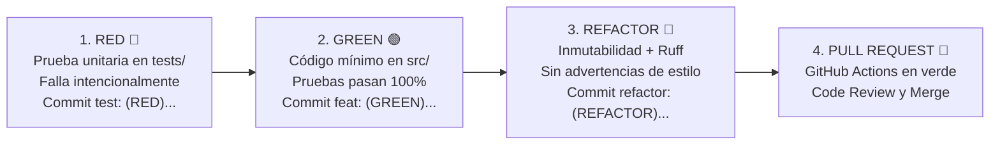

# INFORME DE CONTEXTO TÉCNICO, ARQUITECTURA Y ESTADO DEL PROYECTO
**Sistema de Control de Asistencia y Gestión Administrativa — Colegio Domingo Savio S.A.C.**  
*Documento de Contexto y Especificación Integral para Agentes de Inteligencia Artificial y Equipo de Ingeniería*

---

## 1. Contexto General y Objetivos del Negocio

* **Entidad Aliada:** Colegio Domingo Savio S.A.C. (Institución Educativa Privada).
* **Marco Académico:** Asignatura *Construcción de Software* — Facultad de Ingeniería de Sistemas e Informática, Universidad Continental.
* **Cátedra:** Mg. Ing. David H. Carrillo Yépez.
* **Equipo de Desarrollo:** Grupo Conti2000.
* **Problema Operacional Identificado:**
  La gestión de asistencia tradicional del colegio depende de toma de lista manual en aula (pérdida de 10 a 15 minutos diarios) y verificación visual vulnerable en portería. Esto produce aglomeraciones en horas pico, riesgos de suplantación si se extravía un carnet y falta de visibilidad en tiempo real del aforo del plantel y récord de tardanzas/ausencias.
* **Solución Técnica:**
  Sistema automatizado bajo **Clean Architecture** y **Domain-Driven Design (DDD)** con backend en Python, persistencia relacional con **SQLAlchemy 2.0**, desarrollo guiado por pruebas (**TDD** con `pytest`), inspección estática rigurosa con **Ruff** y pipeline automatizado de **CI/CD** con GitHub Actions.

---

## 2. Equipo de Desarrollo y Asignación Formal de Roles

Cada integrante del equipo tiene responsabilidades técnicas específicas que deben respetarse en la división del trabajo:

| Rol Técnico | Integrante Responsable | Responsabilidades Clave |
| :--- | :--- | :--- |
| **DevOps & QA Engineer** | **Jacob Luna Basilio** | Configuración y mantenimiento del pipeline CI/CD en GitHub Actions (`.github/workflows/ci.yml`), automatización de calidad con linter **Ruff**, diseño del fixture hermético de base de datos en memoria (`conftest.py` con `sqlite:///:memory:`) y certificación de cobertura con `pytest-cov` ($\ge 70\%$ obligatorio, meta 100% en dominio). |
| **Product Owner / Scrum Master** | **Gari Joel Chávez Huanca** | Gestión del Product Backlog, formalización de criterios de aceptación BDD (Gherkin), administración de ramas Git, revisión de código (*Code Review*) y aprobación final de Pull Requests hacia `main`. |
| **Database & ORM Specialist** | **Eduardo Luna Lezano** | Diseño del Modelo Entidad-Relación (ERD), mapeo relacional con SQLAlchemy 2.0 en `src/infraestructura/modelos.py`, modelado de relaciones 1:N y N:M, políticas de eliminación en cascada (`cascade="all, delete-orphan"`). |
| **Lead Backend Engineer** | **Dudu Fabiano Lizarzaburu Flores** | Arquitectura de la capa de dominio pura (`src/dominio/`), implementación de casos de uso bajo ciclo TDD (Red-Green-Refactor), inmutabilidad y modelado de reglas de negocio. |
| **Analista de Requerimientos** | **Yhovana Quispe Ccolqquere** | Levantamiento y refinamiento de historias de usuario, validación de reglas de negocio con la entidad aliada y coherencia entre requerimientos y casos de prueba. |

---

## 3. Arquitectura del Software y Estándares de Ingeniería

El proyecto aplica **Clean Architecture** con separación estricta de responsabilidades:

```text
Proyecto_-de_gestion_administrativa_de_colegio/
├── .github/
│   └── workflows/
│       └── ci.yml               # CI/CD: Ubuntu-latest + Python 3.11 + Ruff + Pytest con cobertura
├── src/
│   ├── __init__.py
│   ├── dominio/                 # CAPA DE DOMINIO PURA (Zero dependencias de BD/Frameworks)
│   │   ├── __init__.py
│   │   ├── regla_negocio.py     # PBI-01: Evaluación de carnet y cálculo de tardanza
│   │   ├── asistencia_manual.py # PBI-02: Registro manual por DNI y auditoría
│   │   ├── aforo.py             # PBI-03: Dashboard de aforo en tiempo real
│   │   └── justificaciones.py   # PBI-04: Gestión y estados de justificaciones
│   └── infraestructura/         # CAPA DE PERSISTENCIA Y ADAPTADORES EXTERNOS
│       ├── __init__.py
│       └── modelos.py           # Modelos ORM (SQLAlchemy 2.0: DeclarativeBase, Mapped)
├── tests/
│   ├── __init__.py
│   ├── conftest.py              # Fixture db_session con sqlite:///:memory:
│   ├── test_regla_negocio.py    # Pruebas BDD PBI-01
│   ├── test_asistencia_manual.py# Pruebas BDD PBI-02
│   ├── test_aforo.py            # Pruebas BDD PBI-03
│   ├── test_justificaciones.py  # Pruebas BDD PBI-04
│   └── test_persistencia_orm.py # Pruebas TDD de persistencia y cascadas
├── pyproject.toml               # Configuración de herramientas (Ruff y Pytest)
└── requirements.txt             # pytest>=8.0.0, ruff>=0.8.0, pytest-cov>=5.0.0, sqlalchemy>=2.0.0
```

### Reglas de Diseño Técnico
1. **Aislamiento del Dominio:** `src/dominio/` solo contiene lógica de negocio pura en Python estándar. Jamás importa librerías de base de datos, frameworks web ni módulos de infraestructura.
2. **Inmutabilidad y Tipado (DDD):**
   * Las entidades y Value Objects se modelan con `@dataclass(frozen=True)`.
   * Los estados y roles se definen con enumeraciones estrictas (`str, Enum`).
   * Se declaran type hints en todos los parámetros y retornos (`def evaluar(codigo: str, hora: time) -> ResultadoAsistencia:`).
   * Excepciones de dominio semánticas que heredan de una excepción base del módulo.
3. **Linteo y Calidad Estática con Ruff (`pyproject.toml`):**
   * Longitud de línea máxima: **100 caracteres**.
   * Reglas activas: `E` (Pycodestyle errores), `F` (Pyflakes), `I` (Isort orden de imports) y `UP` (Pyupgrade).
4. **Metas de Cobertura:** La capa de dominio debe mantener el **100% de cobertura de código** medida con `pytest-cov`.

---

## 4. Metodología TDD y Flujo Git

El desarrollo de cada funcionalidad avanza únicamente mediante el ciclo **Red-Green-Refactor**:



### Convenciones Estrictas de Commits
* **Fase RED:** `test: (RED) <descripción del escenario de prueba que falla> para PBI-XX`
* **Fase GREEN:** `feat: (GREEN) <descripción de la solución mínima> para PBI-XX`
* **Fase REFACTOR:** `refactor: (REFACTOR) <optimización arquitectónica o validación ruff> en PBI-XX`
* **Mantenimiento y docs:** `chore: ...` y `docs: ...`

### Flujo de Ramas
* Ramas de trabajo derivadas de `main`: `feature/PBI-XX-<descripcion-kebab-case>`
* Ramas de actualización/mejora: `improvement/PBI-XX-<descripcion-kebab-case>`

---

## 5. Arquitectura de Persistencia con ORM (SQLAlchemy 2.0)

La persistencia sigue los lineamientos del *Instructivo Colaborativo 04* y la *Guía de Laboratorio 09*:

1. **Definición de Modelos (`src/infraestructura/modelos.py`):**
   * Clase base: `class Base(DeclarativeBase): pass`
   * Sintaxis declarativa moderna:
     ```python
     id: Mapped[int] = mapped_column(Integer, primary_key=True, autoincrement=True)
     ```
   * Relaciones 1:N bidireccionales con regla de cascada:
     ```python
     asistencias: Mapped[list["AsistenciaModel"]] = relationship(
         "AsistenciaModel", back_populates="estudiante", cascade="all, delete-orphan"
     )
     ```
   * Relaciones N:M mediante tabla asociativa definida previamente:
     ```python
     estudiante_taller = Table(
         "estudiante_taller",
         Base.metadata,
         Column("estudiante_id", ForeignKey("estudiantes.id"), primary_key=True),
         Column("taller_id", ForeignKey("talleres.id"), primary_key=True),
     )
     ```
2. **Fixture Hermético en Memoria (`tests/conftest.py`):**
   * Configurado por el DevOps & QA Engineer (**Jacob Luna Basilio**) para evitar tocar bases de datos reales o generar residuos entre pruebas:
     ```python
     import pytest
     from sqlalchemy import create_engine
     from sqlalchemy.orm import sessionmaker
     from src.infraestructura.modelos import Base

     @pytest.fixture(scope="function")
     def db_session():
         """Entrega una sesión aislada de SQLite en memoria para cada test."""
         engine = create_engine("sqlite:///:memory:", echo=False)
         Base.metadata.create_all(bind=engine)
         session = sessionmaker(bind=engine)()
         yield session
         session.close()
         engine.dispose()
     ```
3. **Ciclos TDD de Persistencia:**
   * **Ciclo 1:** Guardar y consultar relación 1:N (`test: (RED)` $\rightarrow$ `feat: (GREEN)` $\rightarrow$ `refactor: (REFACTOR)`).
   * **Ciclo 2:** Relación N:M si el módulo lo demanda.
   * **Ciclo 3:** Eliminación en cascada (`test_eliminar_padre_elimina_hijos`).

---

## 6. Estado Actual del Proyecto ("¿En qué estamos ahorita?")

El proyecto presenta una transición clara entre lo ya integrado en el repositorio central y el trabajo avanzado en el workspace local listo para merge/persistencia:

```text
           REPOSITORIO CENTRAL (main)             │              WORKSPACE LOCAL (Listo)
─────────────────────────────────────────────────┼─────────────────────────────────────────────
• PBI-01 V1 integrado (PR #2 mergeado a main)    │ • pbi-01/: Versión mejorada V2 (dataclass,
  - Cálculo básico con tolerancia a las 07:15    │   segundos exactos, <200ms, Enum)
  - 4 pruebas unitarias con 100% de cobertura    │ • pbi-02/: Asistencia Manual y Auditoría
  - Pipeline GitHub Actions configurado          │ • pbi-03/: Dashboard Aforo en Vivo
• pyproject.toml y requirements.txt configurados │ • pbi-04/: Gestión de Justificaciones
                                                 │ • Guías 04 y 09: Modelos ORM por mapear
```

### A. Lo que ya está completado y mergeado en el repositorio central (`main`)
1. **Estructura base del proyecto:** Configurada en el commit `63bda2f` y PR `#1`.
2. **Pipeline de Integración Continua (CI/CD):** `.github/workflows/ci.yml` ejecutando Ruff y Pytest con reporte de cobertura sobre Ubuntu y Python 3.11.
3. **PBI-01 (Versión Inicial):**
   * Código: `src/dominio/regla_negocio.py`.
   * Pruebas: `tests/test_regla_negocio.py` (4 casos de prueba pasando en verde: puntualidad, tardanza, tolerancia exacta a las 07:15:00 y carnet anulado).
   * Commits registrados del ciclo TDD:
     * `3ad2e5c test: (RED) agregar pruebas de puntualidad, tardanza y carnet anulado para PBI-01`
     * `46df9ab feat: (GREEN) implementar cálculo mínimo de asistencia y tardanza para PBI-01`
     * `97e3d77 refactor: (REFACTOR) estructurar con dataclass inmutable y validar con ruff en PBI-01`
     * PR `#2` mergeado a `main` por Joel Chávez Huanca.

### B. Lo que está desarrollado y listo en las carpetas locales (`pbi-01` a `pbi-04`)
En el espacio de trabajo se han preparado las versiones completas alineadas a la especificación formal BDD:

* **Mejora PBI-01 (`pbi-01/`):**
  * Corrige el redondeo de segundos mediante $\lceil \frac{\Delta t}{60} \rceil$ desde las 07:15:00.
  * Valida desempeño con procesamiento en $< 200\text{ ms}$.
  * Implementa Value Object inmutable `ResultadoAsistencia` con `@dataclass(frozen=True)` y enums `EstadoAsistencia` y `EstadoCarnet`.
  * Rama preparada: `improvement/PBI-01-actualizacion-criterios-bdd`.
* **PBI-02: Registro Manual de Asistencia por DNI (`pbi-02/`):**
  * Código: `asistencia_manual.py` y `test_asistencia_manual.py`.
  * Reglas implementadas: DNI de 8 dígitos numéricos, autorización exclusiva para `PORTERIA` y `ADMIN`, validación de alumno `ACTIVO`, corrección permitida solo sobre estado `AUSENTE`, prohibición de sobrescribir `JUSTIFICADO`, y rastro inmutable de auditoría.
  * Rama preparada: `feature/PBI-02-asistencia-manual-auditoria`.
* **PBI-03: Dashboard de Aforo en Tiempo Real (`pbi-03/`):**
  * Código: `aforo.py` y `test_aforo.py`.
  * Reglas implementadas: Conteo en tiempo real de matriculados, presentes, tardanzas, ausentes, justificados y pendientes; porcentaje de asistencia global y desglose por aula (`ResumenSalon`); autorización restringida a `DIRECTOR` y `ADMIN`.
  * Rama preparada: `feature/PBI-03-dashboard-aforo-tiempo-real`.
* **PBI-04: Gestión de Justificaciones de Inasistencia (`pbi-04/`):**
  * Código: `justificaciones.py` y `test_justificaciones.py`.
  * Reglas implementadas: Categorías (`MEDICA`, `PERMISO_FAMILIAR`, `OTRA`), cambio atómico de `AUSENTE`/`TARDANZA` a `JUSTIFICADO`, restauración al estado anterior si se elimina la justificación, bloqueo si el período está cerrado o si la fecha es futura.
  * Rama preparada: `feature/PBI-04-gestion-justificaciones`.

### C. Lo que está pendiente por realizar (Próximos pasos inmediatos)
1. **Persistencia ORM (Instructivo Colaborativo 04):**
   * Agregar `sqlalchemy` a `requirements.txt`.
   * Crear la capa `src/infraestructura/modelos.py` mapeando las entidades del ERD (`EstudianteModel`, `AsistenciaModel`, `JustificacionModel`, etc.).
   * Crear `tests/conftest.py` con el fixture `db_session`.
   * Desarrollar `tests/test_persistencia_orm.py` aplicando los 3 ciclos TDD (1:N, N:M y eliminación en cascada).
2. **Integración al repositorio de los PBIs preparados:** Integrar secuencialmente mediante ramas y PRs los módulos PBI-02, PBI-03 y PBI-04.
3. **PBIs restantes en el Backlog (PBI-05 al PBI-15):**
   * PBI-05: Ficha de Matrícula Digital.
   * PBI-06: Emisión y anulación de Carnet Escolar (códigos QR y caché).
   * PBI-07: Control de pagos y alerta silenciosa a tesorería.
   * PBI-08 a PBI-10: Malla curricular, notas vigesimales y asignación docente.
   * PBI-11 a PBI-13: Ficha acumulada, exportación a Excel/PDF y boletas bimestrales.
   * PBI-14 y PBI-15: Control de acceso basado en roles (RBAC) y auditoría inmutable transversal.

---

## 7. Instrucciones Operativas para la IA (Modo de Ejecución)

Cuando una IA trabaje con este contexto para generar nuevo código o resolver un requerimiento, debe regirse por los siguientes principios:

1. **Reconocer la autoridad y especialidad técnica del equipo:**
   * QA, pipelines, linteo y fixtures herméticos: supervisado por **Jacob Luna Basilio**.
   * ERD, esquemas de bases de datos y ORM: **Eduardo Luna Lezano**.
   * Arquitectura de dominio y lógica pura: **Dudu Fabiano Lizarzaburu Flores**.
   * Gestión de backlog, criterios BDD y aprobación de PRs: **Gari Joel Chávez Huanca**.
   * Requerimientos y casos de usuario: **Yhovana Quispe Ccolqquere**.
2. **Generar siempre la secuencia TDD completa:** Entregar obligatoriamente la prueba unitaria primero (Fase RED con su commit), luego el código mínimo de producción (Fase GREEN con su commit), y finalmente el código refactorizado con dataclasses y validación de Ruff (Fase REFACTOR con su commit).
3. **Respetar la pureza de capas:** Nunca colocar consultas a la base de datos dentro de `src/dominio/`. Toda persistencia debe residir en `src/infraestructura/modelos.py` o en repositorios dedicados.
4. **Cumplir con el linteo:** Mantener todas las líneas por debajo de los 100 caracteres y tipar rigurosamente cada función sin warnings de Ruff.

