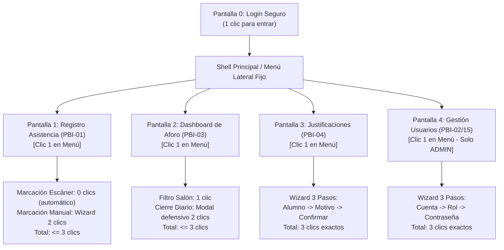

# Especificación Técnica de Interfaces Gráficas y Diseño UX/UI
**Sistema de Control de Asistencia y Gestión Administrativa — Colegio Domingo Savio S.A.C.**  
*Documento de Diseño Frontend, Arquitectura de Información y Guía de Usabilidad*

---

## 1. Fundamentos y Directrices Pedagógicas de Clase

El diseño de las interfaces gráficas se fundamenta en las directrices de clase de la cátedra de *Construcción de Software* (Mg. Ing. David H. Carrillo Yépez) y en los estándares internacionales de usabilidad:

### 1.1. Diferencia Fundamental entre UX y UI
* **UX (User Experience):** Estructura del flujo, ergonomía operativa, velocidad de respuesta en portería ($< 200\text{ ms}$) y resolución eficiente de tareas sin frustración ni pérdida de datos.
* **UI (User Interface):** Componentes visuales, paleta semántica institucional, tipografía, espacios en blanco, microinteracciones y controles de selección accesibles.

```text
EL ICEBERG DEL DISEÑO CENTRADO EN EL USUARIO:
  1. Superficie (UI)   ▲  Botones, colores, iconos, tipografía (lo visible)
───────────────────────┼────────────────────────────────────────────────────────
  2. Esqueleto         │  Disposición espacial, Multi-Step Wizards, tarjetas
  3. Estructura (UX)   │  Arquitectura de la información, Regla de los 3 clics
  4. Alcance           │  Criterios BDD de PBI-01, PBI-02, PBI-03 y PBI-04
  5. Estrategia        ▼  Operación fluida en portería escolar y administración
```

### 1.2. Las Cuatro Reglas Obligatorias de Diseño
1. **Regla de los 3 Clics:** Cualquier función o registro del sistema debe alcanzarse y completarse en un máximo de **3 clics** desde el inicio de sesión.
2. **Selection Controls Obligatorios:** Prohibido el uso de campos de texto libre para datos predeterminados. Uso estricto de *Radio Buttons*, *Toggle Switches*, *Dropdowns/Selects*, *Segmented Controls* y *DatePickers*.
3. **Formularios por Pasos (Multi-Step Form / Wizard):** Procesos con más de 3 datos agrupados en asistentes progresivos con indicador de pasos (*Stepper*), evitando pantallas saturadas de campos.
4. **Validación en Línea (Inline Validation):** Validación en tiempo real carácter por carácter (*onInput / onBlur*) con indicadores visuales inmediatos (borde verde/rojo y mensajes de ayuda accionables).

### 1.3. Regla de Oro en Arquitectura de Software
> [!IMPORTANT]
> **La Interfaz Gráfica NUNCA ejecuta sentencias SQL directas ni implementa lógica de cálculo horario.**  
> La UI actúa únicamente como canal de captura de eventos y presentación de respuestas. Toda la lógica de negocio se delega a la capa pura probada con TDD en `src/dominio/`.

---

## 2. Mapa de Navegación Global (Arquitectura de los 3 Clics)

El sistema utiliza un **Master Layout con Sidebar Persistente**, garantizando que cualquier pantalla operativa esté a 1 clic de distancia:



---

## 3. Especificación Detallada de Interfaces Gráficas

---

### Pantalla 0: Inicio de Sesión y Control de Acceso (Login Seguro)
* **PBI Asociado:** PBI-02 (Cuentas) y PBI-15 (RBAC).
* **Usuarios Autorizados:** `ADMIN`, `COORDINADOR`, `ADMIN_STAFF`.

#### Boceto Estructural (Wireframe)
```text
┌─────────────────────────────────────────────────────────────┐
│                 COLEGIO DOMINGO SAVIO S.A.C.                │
│             Sistema de Gestión y Control Escolar            │
├─────────────────────────────────────────────────────────────┤
│                                                             │
│   Nombre de Usuario:                                        │
│   [ admin_general                                ] (✓) Verde│
│                                                             │
│   Contraseña:                                               │
│   [ •••••••••••••••••                            👁 ]       │
│                                                             │
│   [ Iniciar Sesión ]  ───> [Spinner animado de carga]       │
│                                                             │
│   ⚠️ Banner Inline: "Credenciales incorrectas. Verifique"    │
└─────────────────────────────────────────────────────────────┘
```

#### Especificación de Controles y UX
* **Selection Controls:** Botón toggle interactivo (👁) para conmutar visualización de clave.
* **Inline Validation:**
  * Si el usuario borra el texto, el borde se torna rojo: *"El nombre de usuario es obligatorio"*.
  * Si el campo contraseña tiene menos de 8 caracteres al desenfocar: *"La contraseña debe tener mínimo 8 caracteres"*.
* **Manejo Defensivo en UI:**
  * Ante error de autenticación, el formulario captura `CredencialesInvalidasError` y resalta los campos sin borrarlos.
* **Desacoplamiento:** Invoca `ServicioAutenticacion.autenticar(username, password)`.

---

### Pantalla 1: Registro Unificado de Asistencia en Puerta (PBI-01)
* **PBI Asociado:** PBI-01 (Lectura de Carnet QR/PC/Celular, Manual DNI y Búsqueda).
* **Meta de Rendimiento UX:** Confirmación visual completa en **menos de 200 ms**.

#### Boceto Estructural (Wireframe)
```text
┌──────────────────────────────────────────────────────────────────────────────┐
│ CONTROL DE ASISTENCIA                  Operador: jluna_qa (ADMIN_STAFF) [🟢] │
├──────────────────────────────────────────────────────────────────────────────┤
│ MODO DE OPERACIÓN (Selection Controls - Segmented Buttons):                  │
│ [ ● 1. Escáner Carnet (QR) ]   [ ○ 2. Manual por DNI ]   [ ○ 3. Búsqueda ]   │
├──────────────────────────────────────────────────────────────────────────────┤
│ ZONA DE ENTRADA (Foco automático continuo):                                  │
│ Ingrese código o escanee:                                                    │
│ [ CRN-EDU-72945734                           ] ⚡ Procesando en 18 ms...      │
├──────────────────────────────────────────────────────────────────────────────┤
│ TARJETA VISUAL DE CONFIRMACIÓN INMEDIATA (Feedback de Estado):               │
│ ┌──────────────────────────────────────────────────────────────────────────┐ │
│ │  🟢 INGRESO PUNTUAL CONFIRMADO                                           │ │
│ │  Estudiante: Eduardo Luna Lezano   |  Código: ALU-2026-001               │ │
│ │  Aula: Secundaria - 5.° de Secundaria - Sección A                        │ │
│ │  Hora Registrada: 07:12:04  |  Tardanza: 0 min  |  Método: CARNET        │ │
│ └──────────────────────────────────────────────────────────────────────────┘ │
└──────────────────────────────────────────────────────────────────────────────┘
```

#### Asistente por Pasos para Registro Manual / Corrección de Ausente
Si el operador selecciona **Manual por DNI** o requiere corregir un alumno marcado previamente como `AUSENTE`:

```text
[ Paso 1: DNI ] ───────> [ Paso 2: Validación Alumno ] ───────> [ Paso 3: Motivo ]
```
* **Paso 1 (Identificación):**
  * Campo numérico con **Inline Validation**: máscara fija de 8 dígitos.
  * Muestra borde rojo si contiene letras o menos de 8 dígitos (*"Debe contener exactamente 8 números"*). Al completar el 8.° dígito válido, cambia automáticamente a verde (✓) y consulta al alumno.
* **Paso 2 (Verificación de Alumno):**
  * Presenta tarjeta con fotografía, nombre completo, salón y estado actual (`ACTIVO`).
* **Paso 3 (Motivo de Corrección obligatoria si está en AUSENTE):**
  * **Selection Control:** Dropdown con opciones: `OLVIDO_DE_CARNET`, `FALLA_DE_LECTOR`, `AUTORIZACION_DIRECCION`.
  * Contador inline de caracteres (mínimo 5 caracteres).
  * Botón: *"Confirmar Asistencia"*.
* **Manejo Defensivo:**
  * Si el alumno ya marcó hoy, captura `RegistroDuplicadoError` y presenta tarjeta ámbar: *"⚠️ El alumno ya cuenta con registro a las 07:10:00"*. La pantalla no se recarga ni borra el historial.
* **Desacoplamiento:** Invoca `ServicioRegistroAsistencia.registrar()`.

---

### Pantalla 2: Dashboard de Aforo en Tiempo Real y Cierre Escolar (PBI-03)
* **PBI Asociado:** PBI-03 (Métricas globales, desglose por aula y cierre de jornada).
* **Usuarios Autorizados:** `ADMIN`, `COORDINADOR`, `ADMIN_STAFF`.

#### Boceto Estructural (Wireframe)
```text
┌──────────────────────────────────────────────────────────────────────────────┐
│ DASHBOARD DE AFORO EN VIVO                 Fecha: 11/11/2026 | Hora: 07:45   │
├──────────────────────────────────────────────────────────────────────────────┤
│ SELECTION CONTROLS (Filtros de Ámbito Académico):                            │
│ Nivel:   [ Todos        ▼ ]   Grado: [ 3.° Primaria  ▼ ]   Sección: [ A    ▼ ]│
├──────────────────────────────────────────────────────────────────────────────┤
│ TARJETAS KPI DE IMPACTO VISUAL:                                              │
│ ┌──────────────┐ ┌──────────────┐ ┌──────────────┐ ┌──────────────────────┐  │
│ │ Matriculados │ │  Presentes   │ │  Tardanzas   │ │    % Asistencia      │  │
│ │     430      │ │   380 (🟢)   │ │    25 (🟡)   │ │       94.1%          │  │
│ └──────────────┘ └──────────────┘ └──────────────┘ └──────────────────────┘  │
├──────────────────────────────────────────────────────────────────────────────┤
│ BARRAS DE PROGRESO POR SALÓN:                                                │
│ • Primaria 3.° A:  [██████████████████░░░░] 28/30 alumnos (93.3%)             │
│ • Secundaria 5.° B:[████████████████████] 32/32 alumnos (100.0%)            │
├──────────────────────────────────────────────────────────────────────────────┤
│ ZONA PROTEGIDA: CIERRE ESCOLAR DIARIO                                        │
│ Hora Cierre Configurada: [ 08:30:00 ] (Modificable solo por ADMIN)           │
│ [ 🔒 Ejecutar Cierre Diario ] ───> Abre Diálogo Modal Defensivo en 2 Pasos   │
└──────────────────────────────────────────────────────────────────────────────┘
```

#### Modal Defensivo para Acción Crítica (Cierre Escolar)
Para evitar ejecuciones accidentales que marquen faltas irreversibles:
* **Paso 1:** Al presionar "Ejecutar Cierre Diario", se despliega un diálogo emergente:  
  *"Existen 25 alumnos en estado PENDIENTE. Al ejecutar el cierre, pasarán atómicamente a AUSENTE"*.
* **Paso 2:** **Selection Control (Checkbox obligatorio):**  
  `[ ] Confirmo que la jornada de ingreso ha concluido y autorizo el cierre.`
* El botón *"Confirmar Cierre Definitivo"* permanece deshabilitado en gris hasta que el usuario marque la casilla.
* **Desacoplamiento:** Invoca `ServicioAforo.ejecutar_cierre()`.

---

### Pantalla 3: Gestión de Justificaciones de Inasistencia (PBI-04)
* **PBI Asociado:** PBI-04 (Registro de justificaciones, cambio de estado y anulación).
* **Patrón Obligatorio:** **Formulario por Pasos (Wizard de 3 Etapas)**.

#### Boceto Estructural (Wireframe)
```text
┌──────────────────────────────────────────────────────────────────────────────┐
│ SOLICITUD Y REGISTRO DE JUSTIFICACIÓN                                        │
├──────────────────────────────────────────────────────────────────────────────┤
│ STEPPER: [ (✓) 1. Alumno ] ───> [ (●) 2. Categoría y Motivo ] ───> [ 3. Fin ]│
├──────────────────────────────────────────────────────────────────────────────┤
│ PASO 2: SUSTENTO Y SELECCIÓN DE CATEGORÍA                                    │
│                                                                              │
│ Categoría Oficial (Selection Control - Radio Buttons):                       │
│ (●) Cita / Descanso Médico (MEDICA)                                          │
│ ( ) Permiso Familiar Escrito (PERMISO_FAMILIAR)                              │
│ ( ) Causa Imprevista de Fuerza Mayor (OTRA)                                  │
│                                                                              │
│ Fecha Escolar a Justificar (Selection Control - DatePicker):                 │
│ [ 📅 10/11/2026 ] (Límite superior fijado en hoy: bloquea fechas futuras)    │
│                                                                              │
│ Motivo Detallado:                                                            │
│ [ Reposo médico certificado por odontología pediátrica tras cirugía...     ] │
│ Caracteres: 68/255 (Mínimo 10 caracteres requeridos) (✓)                     │
│                                                                              │
│ [ < Volver al Paso 1 ]                             [ Siguiente: Paso 3 > ]   │
└──────────────────────────────────────────────────────────────────────────────┘
```

#### Reglas de Validación en Línea y Manejo Defensivo
* **DatePicker con restricción inline:** Deshabilita en el calendario las fechas posteriores al día de hoy para cumplir la regla BDD de rechazar justificaciones en fechas futuras.
* **Validador de longitud de motivo:** Si el motivo tiene menos de 10 caracteres, borde naranja y botón "Siguiente" deshabilitado.
* **Paso 3 (Revisión Final):** Muestra el resumen del cambio de estado (`AUSENTE` $\to$ `JUSTIFICADO`) y el operador autenticado responsable.
* **Desacoplamiento:** Invoca `ServicioJustificaciones.registrar_justificacion()`.

---

### Pantalla 4: Administración de Cuentas de Usuario y Seguridad (PBI-02 y PBI-15)
* **PBI Asociado:** PBI-02 (Cuentas) y PBI-15 (RBAC). Exclusivo para `ADMIN`.
* **Patrón Obligatorio:** **Wizard de 3 Pasos para Creación / Edición**.

#### Boceto Estructural (Wireframe)
```text
┌──────────────────────────────────────────────────────────────────────────────┐
│ ADMINISTRACIÓN DE USUARIOS                                [ + Crear Cuenta ] │
├──────────────────────────────────────────────────────────────────────────────┤
│ ASISTENTE: [ 1. Identidad ] ───> [ (●) 2. Rol y Estado ] ───> [ 3. Password ]│
├──────────────────────────────────────────────────────────────────────────────┤
│ PASO 2: ASIGNACIÓN DE ROL OFICIAL Y ESTADO OPERATIVO                         │
│                                                                              │
│ Nombre de Usuario: yquispe_backend (✓ Disponible en servidor)                │
│                                                                              │
│ Rol Oficial Asignado (Selection Control - Radio Cards):                      │
│ ┌───────────────────┐  ┌─────────────────────┐  ┌───────────────────────────┐│
│ │ ( ) ADMIN         │  │ (●) COORDINADOR     │  │ ( ) ADMIN_STAFF           ││
│ │ Control total de  │  │ Operación total de  │  │ Asistencia y correcciones ││
│ │ configuración     │  │ asistencia escolar  │  │ permanentes sin respaldo  ││
│ └───────────────────┘  └─────────────────────┘  └───────────────────────────┘│
│                                                                              │
│ Estado Operativo (Selection Control - Toggle Switch):                        │
│ [ ON / ACTIVO  ]  (Permite inicio de sesión)                                 │
│                                                                              │
│ [ < Anterior: Paso 1 ]                                [ Siguiente: Paso 3 > ]│
└──────────────────────────────────────────────────────────────────────────────┘
```

#### Especificación de Seguridad e Inline Validation
* **Disponibilidad de Username:** Al terminar de escribir el nombre de usuario, consulta en segundo plano y muestra verde (✓ Disponible) o rojo (✗ Nombre de usuario ya registrado).
* **Roles Oficiales Estrictos:** Radio cards que solo permiten `ADMIN`, `COORDINADOR` y `ADMIN_STAFF` (bloqueando roles obsoletos como `PORTERIA` o `DOCENTE`).
* **Paso 3 (Contraseña):**
  * Medidor de fuerza en tiempo real (barra con cálculo de entropía).
  * Muestra requisitos cumplidos en verde: `[✓ Mínimo 8 caracteres] [✓ Números y letras]`.
* **Desacoplamiento:** Invoca `ServicioGestionUsuarios.crear_usuario()`.

---

## 4. Matriz de Trazabilidad: UI ➔ Dominio ➔ Manejo Defensivo

| Pantalla | Evento / Disparador UI | Método de Capa de Dominio | Excepciones Atrapadas (Manejo Defensivo) | Respuesta Visual en Pantalla |
| :--- | :--- | :--- | :--- | :--- |
| **Login** | Clic en *"Iniciar Sesión"* | `ServicioAutenticacion.autenticar()` | `CredencialesInvalidasError`, `CuentaInactivaError` | Banner ámbar; mantiene inputs intactos sin colapso. |
| **Asistencia** | Escaneo QR o clic en *"Registrar"* | `ServicioRegistroAsistencia.registrar()` | `RegistroDuplicadoError`, `AlumnoNoEncontradoError`, `DniInvalidoError` | Tarjeta de advertencia visual; foco retorna a entrada. |
| **Aforo** | Clic en *"Confirmar Cierre"* | `ServicioAforo.ejecutar_cierre()` | `PermisoDenegadoError`, `CierreYaEjecutadoError` | Cierra modal; notifica éxito o restricción con toast. |
| **Justificaciones** | Clic en *"Guardar Justificación"* | `ServicioJustificaciones.registrar()` | `FechaFuturaError`, `AsistenciaYaJustificadaError` | Mantiene el Wizard en el Paso 2; indica campo inválido. |
| **Usuarios** | Clic en *"Finalizar Creación"* | `ServicioGestionUsuarios.crear_usuario()` | `UsuarioDuplicadoError`, `PasswordDebilError` | Retiene datos del formulario; resalta campo duplicado. |

---

## 5. Plantilla de Implementación en Código (Python UI Desacoplada)

Ejemplo de cómo la vista implementa el **Manejo Defensivo**, los **Selection Controls** y el respeto total a la **Regla de Oro** (cero SQL):

```python
"""Módulo de Presentación: Registro de Asistencia (Ejemplo con arquitectura limpia)."""

from src.dominio.asistencia import (
    AlumnoInactivoError,
    AlumnoNoEncontradoError,
    DniInvalidoError,
    RegistroDuplicadoError,
    ServicioRegistroAsistencia,
    SolicitudRegistroAsistencia,
)


class ControladorVistaAsistencia:
    """Controlador gráfico que conecta la vista con el dominio sin lógica SQL."""

    def __init__(self, servicio_asistencia: ServicioRegistroAsistencia, sesion_actual):
        self.servicio = servicio_asistencia
        self.sesion = sesion_actual

    def al_enviar_asistencia(self, identificador_leido: str, metodo_seleccionado: str):
        # 1. Validación en línea previa en el cliente
        if not identificador_leido.strip():
            self.mostrar_alerta_inline("El código de carnet o DNI no puede estar vacío.")
            return

        try:
            # 2. Creación del objeto de transferencia hacia la capa de negocio
            solicitud = SolicitudRegistroAsistencia(
                identificador=identificador_leido.strip(),
                metodo=metodo_seleccionado,  # Selection Control: 'CARNET' o 'MANUAL_DNI'
                operador=self.sesion.usuario,
            )

            # 3. Invocación limpia al dominio probado con TDD
            resultado = self.servicio.registrar(solicitud)

            # 4. Feedback visual inmediato en menos de 200 ms
            self.renderizar_tarjeta_exito(
                estado=resultado.estado,
                estudiante=resultado.alumno.nombre_completo,
                minutos_tardanza=resultado.minutos_tardanza,
            )

        except RegistroDuplicadoError as err:
            # Manejo defensivo: No rompe la app ni resetea la pantalla
            self.mostrar_toast_advertencia(f"⚠️ Alumno ya registrado: {err.mensaje}")

        except (AlumnoNoEncontradoError, DniInvalidoError, AlumnoInactivoError) as err:
            self.mostrar_toast_error(f"❌ Error de validación: {err.mensaje}")
```
